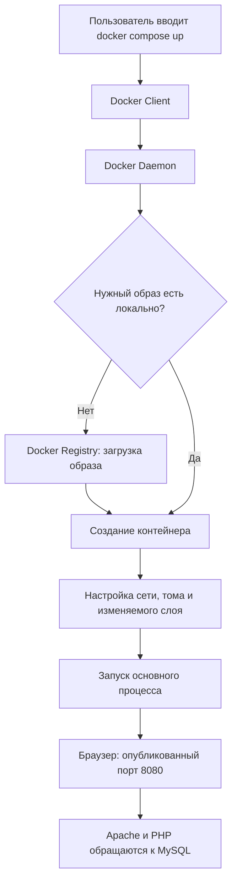

# Лекция 35: Docker на примере MOUVRA

Материал подготовлен по локальной «Лекция35_DevOps.pdf». Команды из документа — учебные примеры; запуск проекта описан отдельно в [php-backend.md](php-backend.md).

## Сценарий показа преподавателю

1. Запустить проект по README и открыть http://127.0.0.1:8080. Состояние API можно проверить через GET /api/health, а число моделей берётся из БД через GET /api/products.
2. Открыть каталог, зарегистрироваться, добавить модель в избранное и корзину, сохранить подборку.
3. Выйти, войти снова: избранное, корзина и история доступны. Можно открыть другое окно браузера и войти с тем же аккаунтом.
4. Показать `docker compose ps`: два контейнера, оба healthy. Выполнить `docker compose logs --tail=20 web`: видны HTTP-запросы.
5. Показать Dockerfile: сначала Node собирает React, затем PHP/Apache получает готовые файлы. Node не запускается как сервер в итоговом контейнере.
6. Показать compose.yaml: публикация порта web, сеть backend, зависимость от готовности MySQL, том mysql_data, ограничения ресурсов.
7. Выполнить `docker compose up -d --force-recreate`, дождаться healthy, обновить кабинет: подборка остаётся. Не удалять том.

## Задание 1. Компоненты Docker

| Компонент | Назначение | Пример проекта |
|---|---|---|
| Client | Передаёт команды службе | CLI `docker compose up` |
| Daemon | Создаёт образы, контейнеры, сети, тома | Служба Docker Desktop |
| Image | Шаблон файловой системы и запуска | mouvra-php-web, mysql:8.4 |
| Container | Изолированный запущенный/остановленный экземпляр образа | web, database |
| Registry | Хранилище образов | Docker Hub для базовых образов |
| Network | Связь контейнеров | backend, адрес database:3306 |
| Volume | Долговременное хранение | mysql_data, каталог /var/lib/mysql |

## Задание 2. Структура веб-проекта

1. `src` содержит исходный код приложения. Здесь PHP-код расположен в `backend/src`, открытая точка входа — `backend/public/api.php`; исходники и SQL не доступны через Apache DocumentRoot.
2. Dockerfile описывает сборку образа: базовое окружение, расширения, файлы и порт.
3. compose.yaml описывает сервисы, образы/сборку, переменные окружения, проброс портов, сети, тома, зависимости и healthcheck.
4. Dockerfile — текстовая инструкция; контейнер — экземпляр созданного образа с процессами, сетью и своим изменяемым слоем.
5. Данные, которые должны пережить удаление контейнера, сохраняются в именованном томе или другом постоянном хранилище. В MOUVRA это том MySQL.

## Задание 3. Dockerfile из лекции

```dockerfile
FROM php:8.3-apache
COPY ./src/ /var/www/html/
EXPOSE 80
```

1. Базовый образ — PHP 8.3 с Apache.
2. Содержимое локального src копируется в /var/www/html внутри образа.
3. Документируется TCP-порт 80.
4. Доступны PHP, Apache, их окружение и скопированное приложение. MySQL этим Dockerfile не устанавливается.
5. EXPOSE не открывает порт на компьютере: нужен `-p 8080:80` либо `ports` в Compose.

В реальном Dockerfile MOUVRA также установлены PDO MySQL и mbstring. Сборка многоэтапная: зависимости Node нужны только для формирования интерфейса. Изменение файлов приложения позволяет повторно использовать слои установленных зависимостей.

## Задание 4. Схема запуска



Для web с `build` перед созданием контейнера собирается собственный образ. MySQL запускается первым; web ждёт успешного healthcheck подключения к базе. Основной процесс web — Apache, database — mysqld.

## Задание 5. Отдельный пример Nginx

Порт 8080 занят MOUVRA, поэтому для независимого примера используйте **8081**. Он не нужен для работы PHP-проекта.

```sh
docker --version
docker images
docker pull nginx
docker run -d -p 127.0.0.1:8081:80 --name mouvra-lecture-nginx nginx
docker ps
docker logs mouvra-lecture-nginx
docker stop mouvra-lecture-nginx
docker ps -a
docker rm mouvra-lecture-nginx
```

После `docker run` откройте http://127.0.0.1:8081 и покажите стартовую страницу Nginx. `stop` завершает процессы, `rm` удаляет именно этот остановленный учебный контейнер. Не запускайте удаление чужих контейнеров или томов. Если имя уже существует, сначала выясните, кому принадлежит контейнер.

## Команды управления из лекции

| Команда | Что показывает или делает |
|---|---|
| docker images | Локальные образы |
| docker pull nginx | Получение образа из реестра |
| docker ps / docker ps -a | Работающие / все контейнеры |
| docker run ... | Создание нового контейнера и запуск |
| docker stop NAME | Остановка процессов контейнера |
| docker start NAME | Повторный запуск существующего контейнера |
| docker restart NAME | Остановка и повторный запуск |
| docker logs NAME | Стандартные потоки логов |
| docker rm NAME | Удаление остановленного контейнера |
| docker rmi nginx | Удаление локального образа, если он больше не нужен |

Compose управляет связанными сервисами вместе; для проекта удобны `docker compose ps`, `logs`, `stop`, `start`, `restart web`. Просмотр слоёв: `docker history mouvra-php-web`. Просмотр ресурсов: `docker stats --no-stream`. Просмотр сети и тома: `docker network inspect mouvra-php_backend`, `docker volume inspect mouvra-php_mysql_data`. Не демонстрируйте полный `docker inspect` контейнеров: переменные окружения содержат пароли.

## Контрольные вопросы

1. **Что такое Docker?** Платформа сборки, распространения и запуска приложений в контейнерах.
2. **Основные компоненты?** Client, Daemon, Image, Container, Registry, Network, Volume.
3. **Client?** Принимает команды человека или программы и обращается к Daemon.
4. **Daemon?** Выполняет операции над образами, контейнерами, сетями и хранилищами.
5. **Image?** Слоистый шаблон окружения с файлами и настройками запуска приложения.
6. **Отличие от Container?** Образ — шаблон; контейнер — экземпляр с процессами и отдельным изменяемым слоем. Изменения контейнера не изменяют исходный образ.
7. **Registry?** Сервер хранения и распространения образов; пример — Docker Hub.
8. **Network?** Сеть контейнеров для обмена данными; имена сервисов позволяют обращаться друг к другу без фиксированных IP.
9. **Volume?** Хранилище вне изменяемого слоя контейнера; переживает его пересоздание, но не явное удаление самого тома.
10. **Структура контейнера?** Файловая система из слоёв образа, собственный изменяемый слой, изолированные процессы и сеть, настройки/ограничения ресурсов. Контейнер использует ядро хостовой Linux-среды, а не отдельное ядро как полноценная виртуальная машина. На Windows Linux-среду предоставляет Docker Desktop.

## Что реализовано сверх лекции

Связанные таблицы и индексы, транзакции, подготовленные SQL-запросы, хеширование паролей, HttpOnly-сессии, ограничение попыток входа, валидация, миграции, повторяемый импорт, снимки цен, защита от повторных заказов, тесты API и запуск существующего React-интерфейса с настоящей БД.
