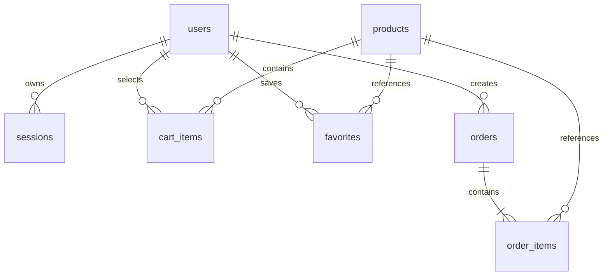

# PHP и MySQL для MOUVRA

## Запуск

Нужен Docker Desktop в режиме Linux containers и Node.js 22.13+. PHP и MySQL устанавливаются внутри контейнеров; отдельный XAMPP не нужен.

```sh
npm run setup:php
docker compose up -d --build
docker compose exec web php /var/www/backend/bin/console.php migrate
docker compose exec web php /var/www/backend/bin/console.php seed
```

Открыть **http://127.0.0.1:8080**. Используйте именно этот адрес: origin запросов должен совпадать с APP_ORIGIN. Для другого порта измените одновременно WEB_PORT и APP_ORIGIN в `.env`, затем пересоздайте web. Секреты создаются случайно; существующий `.env` скрипт не перезаписывает. Если он уже есть от другого окружения, добавьте отсутствующие переменные по `.env.example`.

До выполнения миграции и импорта healthcheck web может быть unhealthy — это означает, что данные ещё не готовы. Миграции и импорт можно повторять: существующие пользователи и заказы сохраняются, товары обновляются из `research/mice.json` без удаления отсутствующих в файле записей. При изменениях кода или JSON сначала пересоберите образ. Миграции защищены от параллельного запуска блокировкой MySQL.

```sh
docker compose ps
docker compose logs --tail=50 web database
docker compose stop
docker compose start
```

`docker compose down` удаляет контейнеры и сеть, но сохраняет именованный том. Не добавляйте `-v`, если нужны данные. Для повторного запуска используйте `docker compose up -d`. Пароли из `.env` инициализируют **новый** том MySQL; простое изменение файла не меняет пароль внутри существующей БД.

## Реальные функции

Создайте аккаунт через кнопку входа → «Зарегистрироваться». Имя, email, хеш пароля, сессии, корзина, избранное и сохранённые подборки находятся в MySQL. Сеанс действует семь дней, выход отзывает его. Демо-кабинет по-прежнему хранит данные только в браузере. Сохранение подборки не оформляет покупку и не списывает деньги.

PHP-сборка загружает каталог через API до отрисовки интерфейса. При недоступности сервера показывает ошибку и повтор загрузки. GitHub Pages сохраняет статический режим; Cloudflare/D1-код остаётся в проекте. Данные D1 автоматически не мигрируются.

## Структура и связи



| Таблица | Одна строка | Защита от дубликатов |
|---|---|---|
| users | Пользователь | Уникальный email |
| sessions | Серверная сессия | Хеш токена — PK |
| auth_attempts | Email+IP либо общий IP | Хеш ключа — PK |
| products | Модель мыши | ID модели — PK |
| cart_items | Модель в корзине пользователя | PK пользователь + модель |
| favorites | Избранная модель пользователя | PK пользователь + модель |
| orders | Сохранённая подборка | Пользователь + ключ идемпотентности |
| order_items | Снимок модели внутри подборки | PK подборка + модель |
| schema_migrations | Применённая версия схемы | Имя SQL-файла — PK |

Цена — DECIMAL(12,2), неизвестная цена — NULL. Количество от 1 до 10. Итоги складываются в целых сотых единицы валюты, отдельно для каждой валюты; цены из тела запроса игнорируются. Избранное не соединяется с позициями заказов при подсчёте сумм, поэтому оно не размножает строки. Снимки заказа не меняются при обновлении каталога. Все даты API — UTC; строки истории отсортированы по дате, возвращаются последние 50.

SQL-проверки числа строк, дубликатов, сумм и NULL находятся в `backend/validation.sql`. Это read-only запросы. Статистика количества строк не должна включать email, хеши паролей или токены при публичной демонстрации.

## API

Все ответы JSON, ошибки `{error: string}`. Для изменяющих запросов обязательны `Content-Type: application/json` и `Origin`, равный APP_ORIGIN. Браузер отправляет Origin автоматически. Сессия — HttpOnly cookie `mouvra_session`, SameSite=Lax; Secure включается при HTTPS в APP_ORIGIN. Не меняйте origin на HTTPS без настройки TLS.

| Метод и путь | Тело | Ответ |
|---|---|---|
| GET /api/health | — | status, database, products; 503 при неготовности |
| GET /api/products | — | products, verifiedAt |
| POST /api/register | name, email, password | user, state; 201 |
| POST /api/login | email, password | user, state |
| POST /api/logout | {} | ok |
| GET /api/account | — | user, state, orders |
| PUT /api/state | cart: [{id,quantity}], favorites: [id] | state |
| PATCH /api/profile | name | user |
| POST /api/orders | {} | order; 201 либо 200 для повторного ключа |

Для POST /api/orders нужен заголовок `Idempotency-Key` (16–80 латинских букв, цифр, `_` или `-`). При повторе с тем же ключом возвращается исходный заказ, даже если корзина успела измениться. Интерфейс сохраняет ключ при ошибке ответа, меняет после успеха или изменения корзины. Ключ хранится в памяти вкладки; перезагрузка после неопределённого результата требует сначала проверить историю. Транзакция и блокировка строки пользователя защищают от одновременных повторов. Корзина после сохранения остаётся.

Коды: 400 — некорректные данные, 401 — нет действующей сессии, 403 — origin, 404 — адрес, 405 — метод, 409 — занятый email, 413 — тело более 16 КБ, 415 — формат, 429 — лимит входа, 503 — сервер/БД. Лимит: 10 попыток на email+IP и 200 на IP за 15 минут. IP берётся из REMOTE_ADDR, заголовки прокси не считаются доверенными.

## Проверки

```sh
npm test
npm run test:php
npm run typecheck
npm run lint
npm run build:php
npm run build:pages
docker compose exec web sh -c 'find /var/www/backend -name "*.php" -exec php -l {} \;'
```

API-тесты создают отдельные аккаунты со случайными адресами `@example.test`. Запускайте их в локальной учебной БД. TEST_BASE_URL позволяет указать другой origin. Для очистки истёкших сессий и лимитов есть команда `docker compose exec web php /var/www/backend/bin/console.php cleanup`.

## Резервная копия и восстановление

Команда создаёт согласованный дамп InnoDB внутри контейнера, затем копирует файл на хост. Пароль не выводится. Перед копированием убедитесь, что `backup.sql` не содержит нужной старой копии; храните резервные копии вне Git.

```sh
docker compose exec database sh -c 'MYSQL_PWD="$MYSQL_ROOT_PASSWORD" mysqldump -uroot --single-transaction --no-tablespaces --set-gtid-purged=OFF mouvra > /tmp/mouvra-backup.sql'
docker compose cp database:/tmp/mouvra-backup.sql ./backup.sql
```

Восстановление **заменяет данные**. Выполняйте только в выбранной тестовой/восстанавливаемой БД и после своей резервной копии. Эти команды приведены для оператора, автоматически они не выполняются:

```sh
docker compose stop web
docker compose cp ./backup.sql database:/tmp/mouvra-restore.sql
docker compose exec database sh -c 'MYSQL_PWD="$MYSQL_ROOT_PASSWORD" mysql -uroot mouvra < /tmp/mouvra-restore.sql'
docker compose start web
```

## Границы версии

Это полноценное локальное приложение для каталога и подборок. Нет оплаты, доставки, склада, админ-панели, email-проверки и почтового восстановления пароля. Для публичного сервера потребуются TLS, управление секретами, резервные копии, мониторинг и отдельные настройки доверенных прокси. Локальный Compose публикует только 127.0.0.1; порт MySQL на хост не открыт.

Использованы официальные рекомендации: [PDO prepared statements](https://www.php.net/pdo.prepare), [password_hash](https://www.php.net/function.password-hash), [порядок запуска Compose](https://docs.docker.com/compose/how-tos/startup-order/).
